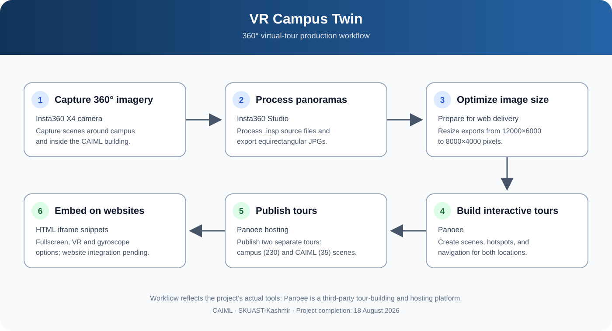

# VR Campus Twin

### Development of 360° Virtual Tours for SKUAST-K Campus and CAIML

An academic project to make the **SKUAST-Kashmir campus** and the **Centre for Artificial Intelligence and Machine Learning (CAIML)** explorable through interactive 360° virtual tours.

> **Project scope:** The team captured and processed 360° imagery and created the tours using Insta360 Studio and Panoee. Panoee is a third-party tour authoring and hosting platform; it was not developed by this project team.

## Explore the tours

| Virtual tour | Coverage | Scenes |
|---|---|---:|
| [SKUAST-K Campus](https://tour.panoee.net/6a7a0bea123af5701c233152) | Outdoor campus | 230 |
| [CAIML — Discovery Building](https://tour.panoee.net/6a32d4bdd0e5ab828601d2fb) | Indoor building | 35 |

Both tours are hosted separately on Panoee and include interactive scene navigation and VR support. Embedding them into the official university websites is a separate step for the relevant website administrators.

## Tour previews

### SKUAST-K Campus


[**Open the campus virtual tour →**](https://tour.panoee.net/6a7a0bea123af5701c233152)

### CAIML — Discovery Building


[**Open the CAIML virtual tour →**](https://tour.panoee.net/6a32d4bdd0e5ab828601d2fb)

## Project workflow



1. **Capture:** Take 360° photographs using the Insta360 X4.
2. **Process:** Process the source files in Insta360 Studio and export equirectangular JPG panoramas.
3. **Optimize:** Reduce panorama resolution for web delivery.
4. **Build:** Import panoramas into Panoee and configure scenes, hotspots, and navigation.
5. **Publish:** Publish the campus and CAIML tours separately.
6. **Prepare for integration:** Use the supplied iframe snippets when embedding the tours on approved websites.

## Tools and technologies

| Tool | Use in this project |
|---|---|
| **Insta360 X4** | Capture 360° imagery |
| **Insta360 Studio** | Process `.insp` files and export panoramic JPG images |
| **Panoee** | Build, configure, publish, and host the interactive tours |
| **HTML iframe** | Provide website-embedding snippets for each tour |
| **GitHub** | Maintain project documentation, workflow diagram, screenshots, and embed snippets |

## Image preparation

The project report records an original panorama export resolution of **12000 × 6000 pixels**, reduced to **8000 × 4000 pixels** for the published tours. The report describes an original dataset of approximately **6 GB** and a Panoee free-tier storage allowance of **3 GB** at the time of the project.

## Repository structure

```text
vr-campus-twin/
├── README.md
├── .gitignore
├── assets/
│   ├── architecture/
│   │   └── workflow.svg
│   └── screenshots/
│       ├── campus-tour-overview.jpg
│       └── caiml-tour-overview.jpg
├── docs/
│   ├── project-report.md
│   ├── methodology.md
│   └── team-and-credits.md
├── embeds/
│   ├── README.md
│   ├── campus-embed.html
│   └── caiml-embed.html
└── tours/
    ├── campus-tour.md
    └── caiml-tour.md
```

## Documentation

- [Project report (Markdown)](docs/project-report.md)
- [Methodology and workflow notes](docs/methodology.md)
- [Team and credits](docs/team-and-credits.md)
- [SKUAST-K campus tour details](tours/campus-tour.md)
- [CAIML tour details](tours/caiml-tour.md)
- [Campus embed snippet](embeds/campus-embed.html)
- [CAIML embed snippet](embeds/caiml-embed.html)
- [Embed instructions](embeds/README.md)
- [Workflow diagram](assets/architecture/workflow.svg)

## Team and academic details

| Team member | Roll number | Role |
|---|---|---|
| **Arnav Saxena** | BTAI-2024-26 | Team Leader |
| **Mir Faiq** | BTAI-2024-11 | Team Member |
| **Mohammad Fouzan** | BTAI-2024-23 | Team Member |

- **Programme:** B.Tech Artificial Intelligence (2024 batch)
- **Centre:** Centre for Artificial Intelligence and Machine Learning (CAIML)
- **Institution:** Sher-e-Kashmir University of Agricultural Sciences and Technology of Kashmir (SKUAST-K)
- **Supervisors:** Dr. Showkat Rasool and Mr. Mohammad Saqib Dar
- **Project duration:** April–August 2026 (approximately four months)
- **Completion date:** 18 August 2026
- **Project context:** Departmental initiative; not the team's final B.Tech project.

## Future scope

- Bring the two tours together as part of a broader campus digital twin.
- Extend CAIML coverage to its outdoor surroundings.
- Add contextual information overlays for important locations.
- Explore a more comprehensive VR-based campus experience.

## Notes

- The full high-resolution panorama dataset is intentionally not stored in this repository.
- Obtain the necessary university permissions before embedding tours on official websites or publishing images of restricted areas.
- Browser support and permissions may affect gyroscope/device-motion behavior in embedded tours.
- The published tours are hosted by Panoee; tour availability and platform features depend on that service.

## Acknowledgements

We thank **Dr. Showkat Rasool** and **Mr. Mohammad Saqib Dar** for their supervision and guidance throughout this project.
