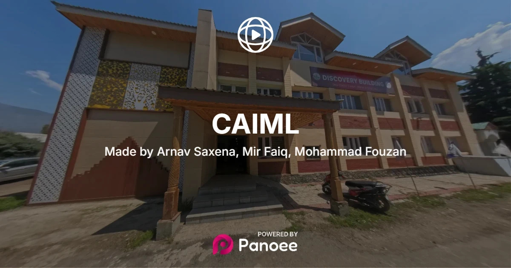
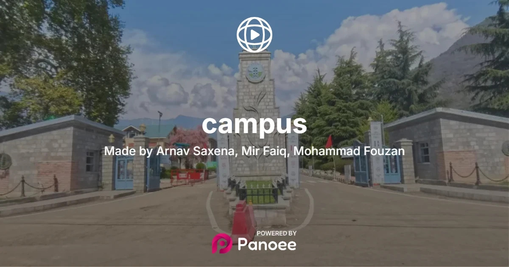

# Development of 360° Virtual Tours for SKUAST-K Campus and CAIML

A university project documenting two web-based 360° virtual tours created with panoramic imagery captured using an Insta360 X4, processed in Insta360 Studio, and assembled and hosted using Panoee.

> **Scope:** Panoee is the third-party virtual-tour builder and hosting platform used in this project. This repository documents the team's capture, image-processing, tour-creation, and embedding work; it does not claim that the team developed Panoee itself.

## Live tours

| Tour | Coverage | Scenes | Link |
|---|---|---:|---|
| SKUAST-K Campus | Outdoor campus | 230 | [Open campus tour](https://tour.panoee.net/6a7a0bea123af5701c233152) |
| CAIML — Discovery Building | Indoor department building | 35 | [Open CAIML tour](https://tour.panoee.net/6a32d4bdd0e5ab828601d2fb) |

Both tours are hosted separately on Panoee. The supplied iframe snippets are in [embeds/](embeds/). Final integration into the official university websites is to be carried out by the relevant website administrators.

## Project objectives

- Create remotely accessible 360° representations of the SKUAST-K campus and CAIML department.
- Capture panoramic imagery and prepare it for web delivery.
- Create two separate interactive tours with scene-to-scene navigation and VR mode.
- Document the workflow, published outputs, and embedding snippets for academic review and future maintenance.

## Tools used

| Tool | Purpose |
|---|---|
| Insta360 X4 | Capture 360° imagery |
| Insta360 Studio | Process `.insp` files and export panoramic JPG images |
| Panoee | Build tours, configure navigation/hotspots, host and embed the tours |
| GitHub | Version project documentation and store workflow and embed snippets |

## Image preparation

According to the project report, the original panoramic exports were 12000 × 6000 pixels and were compressed to 8000 × 4000 pixels. The report describes an original dataset of approximately 6 GB and a Panoee free-tier storage allowance of 3 GB.

## Repository structure

```text
vr-campus-twin/
├── README.md
├── .gitignore
├── docs/
│   ├── project-report.md
│   ├── methodology.md
│   └── team-and-credits.md
├── tours/
│   ├── campus-tour.md
│   └── caiml-tour.md
├── embeds/
│   ├── README.md
│   ├── campus-embed.html
│   └── caiml-embed.html
└── assets/
    ├── architecture/
    │   └── workflow.svg
    └── screenshots/
        ├── campus-tour-overview.jpg
        └── caiml-tour-overview.jpg
```

## Tour screenshots

### CAIML — Discovery Building



*The opening view of the CAIML indoor virtual tour.*

### SKUAST-K Campus



*The opening view of the outdoor campus virtual tour.*

## Project documentation

- [Project report (Markdown)](docs/project-report.md)
- [Methodology and workflow](docs/methodology.md)
- [Team and credits](docs/team-and-credits.md)
- [Campus tour details](tours/campus-tour.md)
- [CAIML tour details](tours/caiml-tour.md)
- [Workflow diagram (SVG)](assets/architecture/workflow.svg)
- [Embed snippets and usage notes](embeds/README.md)

## Team

| Name | Roll number | Role |
|---|---|---|
| Arnav Saxena | BTAI-2024-26 | Team Leader |
| Mir Faiq | BTAI-2024-11 | Member |
| Mohammad Fouzan | BTAI-2024-23 | Member |

**Centre:** Centre for Artificial Intelligence and Machine Learning (CAIML)  
**Programme:** B.Tech AI (2024 batch)  
**Institution:** SKUAST-Kashmir  
**Supervisors:** Dr. Showkat Rasool and Mr. Mohammad Saqib Dar  
**Project duration:** April 2026 – August 2026 (approximately four months)  
**Completion date:** 18 August 2026

## Future scope

- Integrate both tours into a unified campus digital twin.
- Expand CAIML coverage to include outdoor surroundings.
- Add informational overlays for key locations.
- Explore a more comprehensive VR-based campus experience.

## Notes for maintainers

- Test both tour URLs periodically.
- Obtain university approval before embedding tours on official websites or publishing images of restricted areas.
- Do not commit passwords, access tokens, private Panoee settings, or the full high-resolution panorama dataset.
- Test the HTML snippets on the intended website before production use. Some content-management systems accept only iframe markup rather than a full HTML document.

## Acknowledgement

The project was undertaken under the guidance of Dr. Showkat Rasool and Mr. Mohammad Saqib Dar at CAIML, SKUAST-Kashmir.
